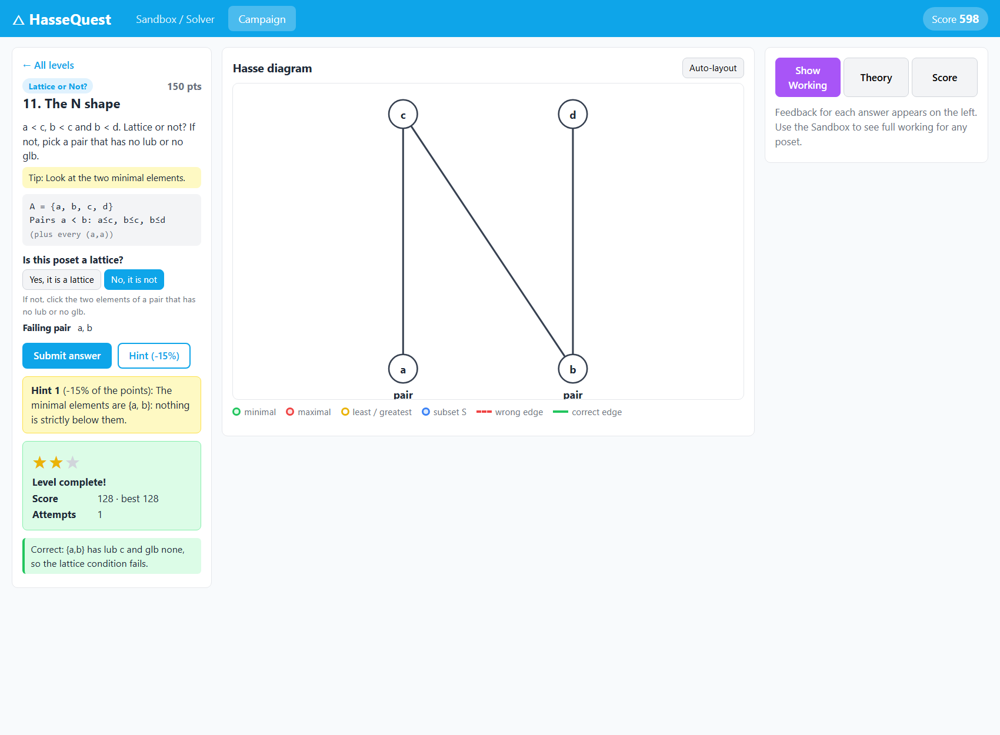

# HasseQuest

**A gamified Discrete Mathematics app for partial orders, Hasse diagrams and lattices.**
ISE-2 project for Discrete Mathematics (7MA206), S.Y. B.Tech. IT, Track A (gamified application).
Syllabus: **Unit III: Relations, POSETs and Functions** (relation properties, partial orders, Hasse diagrams, lattices).

The player gets a set and a relation (for example divisibility on {1, 2, 3, 4, 6, 12}). They have to draw the Hasse diagram, spot special elements, find bounds, repair a relation that is not a partial order, or decide whether a poset is a lattice. A Python mathematics engine checks every move, explains each mistake step by step, and drives the scoring and level unlocks. A **Sandbox / Solver** mode accepts *any* set and relation you type and shows the full analysis with every step of working.

The backend is **Python 3** with **Flask** for the web server and **pytest** for the tests. All the mathematics is written by the team in plain Python (lists, sets and loops, no maths libraries). The frontend is plain HTML, CSS and JavaScript.


## Features

* **Sandbox / Solver** for any set (up to 12 elements) and relation, entered in 4 ways:
  1. pair list: `(1,2), (1,4)` or `1<=2` or `1>2; 2>4`
  2. editable 0/1 matrix
  3. rule: divisibility, subset inclusion (`a`, `ab`, `e` = empty set) or `<=` on numbers, plus "Divisors of n", "Power set of" and random generators
  4. click-to-build on the canvas
* Full analysis with **counterexamples**: reflexive, symmetric, antisymmetric, transitive, equivalence relation (with classes), partial order (says which axiom failed and why, and detects cycles), total order, antichain.
* **Hasse diagram** drawn in levels (smaller below), draggable nodes, auto-layout, colour coding: minimal green, maximal red, least/greatest gold ring, subset blue.
* Minimal / maximal / least / greatest elements, upper and lower bounds, lub and glb of any subset, full **join and meet tables**, lattice verdict with a failing pair, height (longest chain) and width (largest antichain).
* **Show Working** panel: the relation matrix, every property test, **Warshall's algorithm** matrix after each step k, every covering test ("is there c with 1 < c < 4? c=2 yes, so edge (1,4) is removed"), and every lub/glb computation.
* **Practice mode**: hide the edges, draw the diagram yourself and get judged.
* **Campaign** of 13 levels in 6 level types, unlocked in order:

  | Type | Task | Checked by |
  |---|---|---|
  | Build the Hasse | drag the elements and draw the covering edges | `cover_relation` |
  | Spot the Elements | click minimal / maximal / least / greatest | `special_elements` |
  | Bounds Challenge | pick upper and lower bounds, lub and glb of S | `bounds` |
  | Fix the Relation | add the fewest pairs to make R a partial order | `is_partial_order`, `compute_closures` |
  | Lattice or Not? | decide, and justify "no" with a failing pair | `lattice_check` |
  | Boss Level | a random 6 to 9 element poset, all of the above, 3-minute timer | `generators` + all of the above |

* Scoring from the maths: partial credit = correct / (true edges + wrong edges), which combines precision and recall. Hints cost 15% each, extra attempts 5% each, 1 to 3 stars, best scores and history. Every wrong edge gets a specific reason: *redundant* (implied by transitivity), *not in the relation*, *drawn downward*, or *missing* ("b covers a: nothing sits strictly between them").
* Friendly error banners for invalid input, for example *"Pair (2,9) uses '9', which is not in A = {1, 2, 3, 4}"*. No raw server errors are ever shown.

| Campaign: feedback on a drawn diagram | Lattice level |
|---|---|
|  |  |

## Architecture


Three layers (details in [docs/architecture.md](docs/architecture.md)):

* **UI** (`frontend/`): HTML, CSS and vanilla JavaScript with SVG. It only draws and sends data; it contains no mathematics.
* **App** (`app/`): the Flask server (`server.py`), the API routes (`api.py`), game logic, level loading and generators.
* **Math core** (`core/`): pure Python functions on plain lists. No Flask, no JSON, no file I/O, fully unit-tested.

The HTTP API is documented in [docs/API_CONTRACT.md](docs/API_CONTRACT.md).

## Setup

### Requirements

* **Python 3.8 or newer** (the demo laptop uses Python 3.14.5). Check it with `python --version`.
* Any modern browser.
* An internet connection **only once**, for `pip install`. After that everything runs offline: there are no CDN links or online fonts.

### Install (once)

From the project folder, in a terminal (Command Prompt or PowerShell):

```bat
python -m venv venv
venv\Scripts\activate
pip install -r requirements.txt
```

This creates a virtual environment in `venv/` and installs Flask and pytest into it (the exact versions are in `requirements.txt`). On Linux/macOS, activate it with `source venv/bin/activate`.

### Run the tests

```bat
python -m pytest -q
```

It ends with `81 passed`.

### Run the app

```bat
python run.py
```

The console prints `HasseQuest running at http://localhost:8080` and your browser opens automatically. If it doesn't, open **http://localhost:8080** yourself.

Options:

* `python run.py --port 8081` uses another port if 8080 is busy
* `python run.py --no-browser` doesn't open the browser

Stop the server with **Ctrl+C**. Next time, just activate the venv (`venv\Scripts\activate`) and run `python run.py`.

## Usage guide

### Sandbox / Solver

1. Type the elements of A, for example `1, 2, 3, 4, 6, 12`, or use **Divisors of n**, **Power set of**, **Random** or **Load example**.
2. Choose an input method: **Pairs**, **Matrix** ("Make grid from elements", then click cells), **Rule**, or **Click** (click one element and then another to add the pair).
3. Tick **Auto-add reflexive pairs** if you didn't type the pairs (a,a). The result says exactly which pairs were added.
4. Press **Analyze**. The centre shows the Hasse diagram (or, if R is not a partial order, R as a directed graph with the reason). The cards show properties, special elements, lattice verdict and chains, and **Show Working** on the right lists every step.
5. **Bounds**: type a subset S (or tick "Pick S by clicking nodes") and press **Compute bounds**.
6. **Practice**: press **Start practice**, drag elements, click two elements to join them, then **Check my diagram**.

### Campaign

1. Open the **Campaign** tab and pick the first unlocked level.
2. Read the task and the relation on the left, then solve it on the canvas:
   * Build the Hasse / Boss: drag smaller elements lower, click two elements to join them, click an edge to delete it.
   * Spot / Bounds / Lattice: choose a category button, then click elements.
   * Fix the Relation: click cells in the matrix to add pairs.
3. Press **Submit answer**. Feedback explains every mistake. A fully correct answer earns stars and unlocks the next level.
4. **Hint** reveals the minimal elements (hint 1) and one correct piece with its reason (hint 2), at 15% of the points each.
5. The **Score** tab shows the total, stars per level and history. "Demo: unlock all" opens every level for a presentation.

## Folder structure

```
hassequest/
├── run.py                   start the app: python run.py [--port 8080] [--no-browser]
├── requirements.txt         Flask and pytest (pinned versions)
├── core/                    math core: types, util, errors, parsers, relations, poset, hasse, lattice, steps
├── app/                     server (Flask app, errors), api (routes), game, level_loader, generators
├── frontend/                index.html, css/style.css, js/{api,canvas,ui,main}.js
├── data/levels/             campaign levels (index.txt + one file per level type)
├── tests/                   conftest.py, test_*.py, data/*.txt
├── tools/parity_check.py    compares two running servers (used to check the port from C++)
└── docs/                    architecture, API contract, screenshots, DEMO_SCRIPT.md, COMMIT_PLAN.md, report/
```

## Testing

* **81 pytest tests** (`python -m pytest -q`), including **data-driven tests** that loop over 32 poset blocks in `tests/data/posets.txt` and 10 scoring blocks in `tests/data/hasse_checks.txt`. They cover every property true and false, every edge case (empty set, single element, invalid elements, duplicates, non-posets, cycles, chains, antichains, non-lattices, the 12-element limit), parser failures, scoring and feedback.
* `tests/test_api.py` calls every API route and every error case through Flask's test client.
* A regression test checks that a **redundant transitive edge is judged wrong**.
* A **randomized cross-check** builds 300 random posets (fixed seed) and compares `cover_relation` with a separate brute-force implementation.
* The project was first written in C++ and ported to Python. A parity check sent 174 requests to both versions: 171 replies were identical, and the 3 others were exact-half scores, which Python now rounds as the formula says (see [docs/PARITY_REPORT.md](docs/PARITY_REPORT.md)).

## Team and modules

| Member | Module | Main files |
|---|---|---|
| Atharva Patil | Relations, closures, step log, utilities | `core/relations.py`, `core/steps.py`, `core/util.py`, `core/errors.py`, `core/types.py`, `tests/test_relations.py`, `tests/test_util.py` |
| Arnav Parawar | POSET, Hasse and lattice logic | `core/poset.py`, `core/hasse.py`, `core/lattice.py`, `tests/test_poset.py`, `test_hasse.py`, `test_lattice.py`, `tests/data/posets.txt` |
| Shivakiran Dharjane | Parsers, Flask server, test set-up | `core/parsers.py`, `app/server.py`, `run.py`, `requirements.txt`, `pytest.ini`, `tests/conftest.py`, `tests/test_parsers.py`, `tools/parity_check.py` |
| Varad Gaikwad | Game mechanics, API routes, levels, generators | `app/game.py`, `app/api.py`, `app/level_loader.py`, `app/generators.py`, `data/levels/`, `tests/test_game.py`, `test_api.py`, `test_data_driven.py`, `tests/data/hasse_checks.txt` |
| Shivtej Kadlag | Frontend UI, documentation | `frontend/*`, `README.md`, `docs/*` |

## Syllabus coverage

Unit III, Relations, POSETs and Functions: properties of relations (reflexive, symmetric, antisymmetric, transitive), closures and Warshall's algorithm, equivalence relations and classes, partial orders, comparability, chains and antichains, covering relation and Hasse diagrams, minimal/maximal/least/greatest elements, upper and lower bounds, lub and glb, and lattices.
