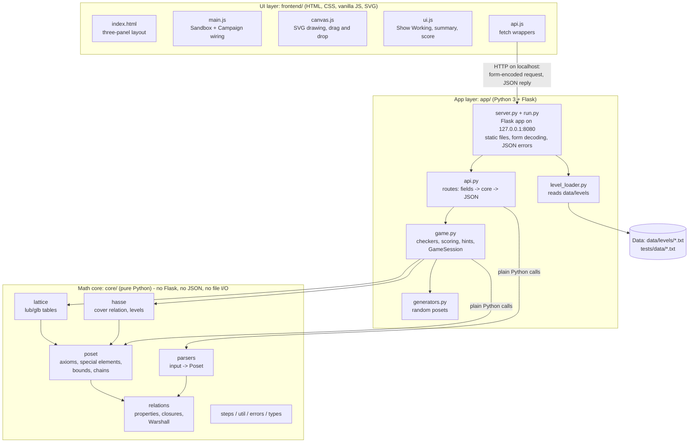

# HasseQuest architecture

Three layers, each only talking to the one below it. `docs/architecture.png` is a picture of the same diagram (its source is `docs/architecture_diagram.html`).

## Rules the code follows

* `core/` never imports Flask, `os` or `json`, and never opens files or prints. It works on plain classes and lists: a `Poset` has `labels` (list of str) and `R` (a list of lists of 0/1). It reports problems by raising `InputError(message, field)`.
* `app/` is the only layer that touches the web (`server.py`, `api.py`) and files (`level_loader.py`). Its error handlers turn `InputError` into `{"ok":false,"error":...,"field":...}`; any other problem becomes a JSON error too, so the server never crashes on bad input.
* `frontend/` contains no mathematics. It sends what the user typed, and draws what comes back. Even the Hasse layout levels come from `hasse_levels`.
* The only mutable state is one `GameSession` object (the single local player's progress).

## One request, end to end (Sandbox "Analyze")

1. `main.js` collects the inputs; `api.js` sends `POST /api/analyze` with `elements=...&mode=pairs&relation=...`.
2. Flask calls the `analyze()` route in `api.py`, which reads the form fields with `server.body_fields()` (our own percent-decoder, so a bad `%ZZ` gives a clear 400 error).
3. `analyze()` calls `build_poset`, `is_partial_order`, `compute_closures`, and if it is a poset `cover_relation`, `hasse_levels`, `special_elements`, `chains_and_antichains`, `lattice_check`, each appending to one shared `steps` list.
4. The route turns the result objects and steps into a dict, and Flask's `jsonify` sends it as JSON.
5. `ui.js` renders the summary cards and the Show Working panel, and `canvas.js` draws the diagram.
