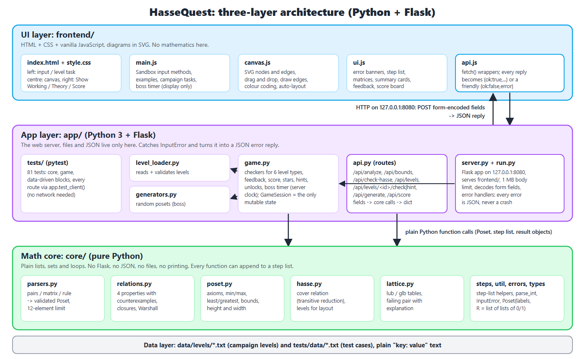
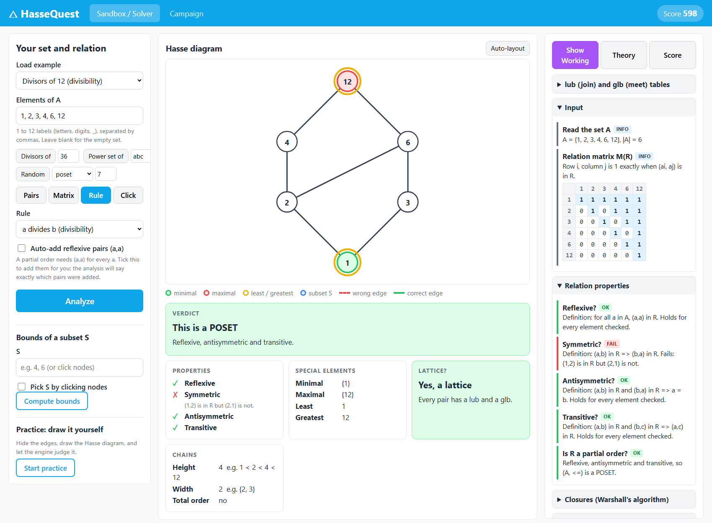
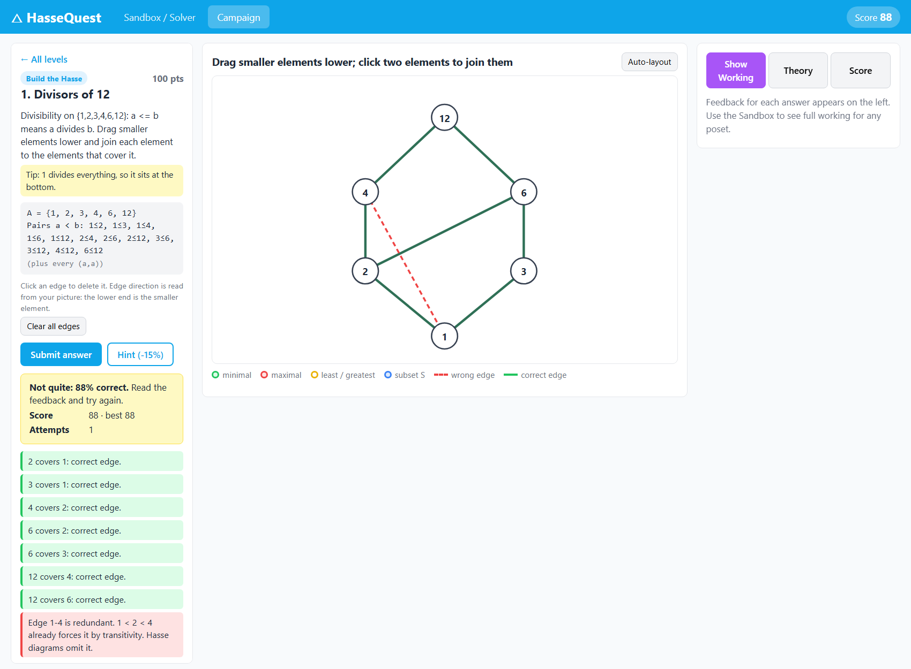

# HasseQuest: A Gamified Explorer for Partial Orders, Hasse Diagrams and Lattices

**Team:** Atharva Patil, Arnav Parawar, Shivakiran Dharjane, Varad Gaikwad, Shivtej Kadlag &nbsp;|&nbsp; **Course:** Discrete Mathematics (7MA206), S.Y. B.Tech. IT, ISE-2, Track A &nbsp;|&nbsp; **Date:** 5 October 2026

## 1. Problem statement and objective

Students often draw Hasse diagrams with transitive edges, confuse *maximal* with *greatest*, and cannot say *why* a poset fails to be a lattice. HasseQuest turns Unit III (relations, POSETs, lattices) into a game in which a Python engine checks every move and explains every mistake. A Sandbox/Solver accepts **any** user-entered set and relation and shows the complete step-by-step analysis.

## 2. Mathematical formulation

For a finite set A and a relation R ⊆ A×A stored as a 0/1 matrix M (M[i][j] = 1 ⇔ (ai,aj) ∈ R):

* **Properties:** reflexive (∀a: (a,a)∈R), symmetric, antisymmetric ((a,b),(b,a)∈R ⇒ a=b), transitive. Each failed test returns a concrete counterexample. A **poset** is reflexive, antisymmetric and transitive; an **equivalence** is reflexive, symmetric and transitive (classes are reported).
* **Warshall's algorithm** (transitive closure R+): for k = 1..n, W[i][j] ← W[i][j] ∨ (W[i][k] ∧ W[k][j]). O(n³); the matrix is logged after every k. R&#42; (reflexive-transitive closure) is the unique minimal fix for the "Fix the Relation" levels, and an R&#42; that is not antisymmetric reveals a cycle.
* **Transitive reduction (Hasse edges):** keep (a,b) with a<b iff there is no c with a<c<b. **Levels** for layout: length of the longest chain from a minimal element (dynamic programming in a bottom-up order).
* **Special elements and bounds:** minimal/maximal (nothing strictly below/above), least/greatest (below/above all). For S ⊆ A: upper bounds U(S), lower bounds L(S); lub = least element of U(S), glb = greatest element of L(S).
* **Lattice test:** build the join and meet tables for all pairs; the first pair without a lub or glb is reported with its reason, e.g. "{2,3} has upper bounds {12, 18, 36} but no least one". Height = longest chain; width = largest antichain (brute force over ≤ 2¹² subsets).

## 3. System architecture

Three layers: a **UI** in vanilla HTML/CSS/JS with SVG (no mathematics), an **app layer** (Flask server, API routes, game logic, level loader, generators) and a **math core** (pure Python functions on plain lists, with no Flask, JSON or file I/O). Requests are form-encoded and replies are JSON. Errors in the core are raised as `InputError(message, field)` and shown as friendly banners.

## 4. Game mechanics and scoring

Sandbox input works in four ways: pair list (`(a,b)`, `a<=b`, `a>b`), editable matrix, rules (divisibility, subset inclusion, ≤, divisors of n, power sets, random) and click-to-build. The campaign has 13 levels in 6 types: **Build the Hasse** (drag and draw, checked by `cover_relation`), **Spot the Elements**, **Bounds Challenge**, **Fix the Relation** (add the fewest pairs = R&#42;∖R), **Lattice or Not?** (justify "no" with a failing pair) and a timed **Boss** on a random 6–9 element poset. Accuracy = correct / (true edges + wrong edges), which combines precision and recall. Score = points × accuracy − 15% per hint − 5% per extra attempt; 1–3 stars; the next level unlocks on a fully correct answer. Every wrong edge gets a specific reason: redundant ("1 < 2 < 4 already forces it"), not in R, drawn downward, or missing ("b covers a: nothing sits strictly between them"). The boss time bonus uses the server's clock.

## 5. Implementation and tech stack

**Python 3** (3.8+ syntax; demo laptop 3.14.5) with **Flask 3.1** for the web server and **pytest 9.1** for tests, installed into a `venv` from `requirements.txt`; nothing else. All mathematics is plain Python: the relation is a list of lists of 0/1 (so Warshall's algorithm reads like the textbook), with no numpy or graph libraries. The Flask server binds to 127.0.0.1:8080, serves the frontend (refusing `..` paths), limits bodies to 1 MB, and its error handlers turn every problem into a JSON error, so bad input never crashes it. The frontend is vanilla JS with SVG drag-and-drop and colour coding (minimal green, maximal red, least/greatest gold, subset blue, wrong edge red-dashed). It starts with `python run.py` and works offline. The backend was first written in C++ and then ported to Python one function at a time, keeping the same API, messages and step logs.

## 6. Testing and results

**81 pytest tests**, including data-driven suites over 32 poset blocks and 10 scoring blocks in `tests/data/*.txt` and every API route through Flask's test client. **All pass.** Coverage includes every property true and false; the edge cases ∅, a single element, elements outside A, duplicate elements/pairs, non-posets and cycles, chains (straight-line diagram), antichains (no edges), multiple minimal elements, non-lattices (N shape, two maximal elements) and the 12-element limit; parser and request failures; and scoring feedback. Two tests are required by the spec: a regression test that a **redundant transitive edge is judged wrong**, and a **randomized cross-check** of `cover_relation` against an independent brute force on 300 random posets (fixed seed). A parity check against the original C++ server gave identical replies for 171 of 174 requests; the other 3 were exact-half scores, which Python now rounds up as the formula says. An end-to-end browser run drove all six level types with real mouse events and recorded no JavaScript errors.

## 7. Screenshots

## 8. Individual contributions

| Member | Module |
|---|---|
| Atharva Patil | Relations, closures and Warshall, step log, utilities, their tests |
| Arnav Parawar | POSET check, special elements, bounds, chains, Hasse cover relation, lattice, their tests |
| Shivakiran Dharjane | Parsers and validation, Flask server and error handling, test set-up, parity tool |
| Varad Gaikwad | Game checkers, scoring and hints, API routes, level loader and levels, generators, game and API tests |
| Shivtej Kadlag | Frontend (layout, SVG canvas, campaign screens), README, report, demo script |

## 9. Conclusion and future work

HasseQuest checks arbitrary relations correctly (confirmed by the brute-force cross-check), explains each step, and makes the mathematics drive the game. Future work: distributive and complemented lattice checks, Boolean algebra levels, topological sorting challenges, saving progress to a file, and larger posets with smarter layout.
